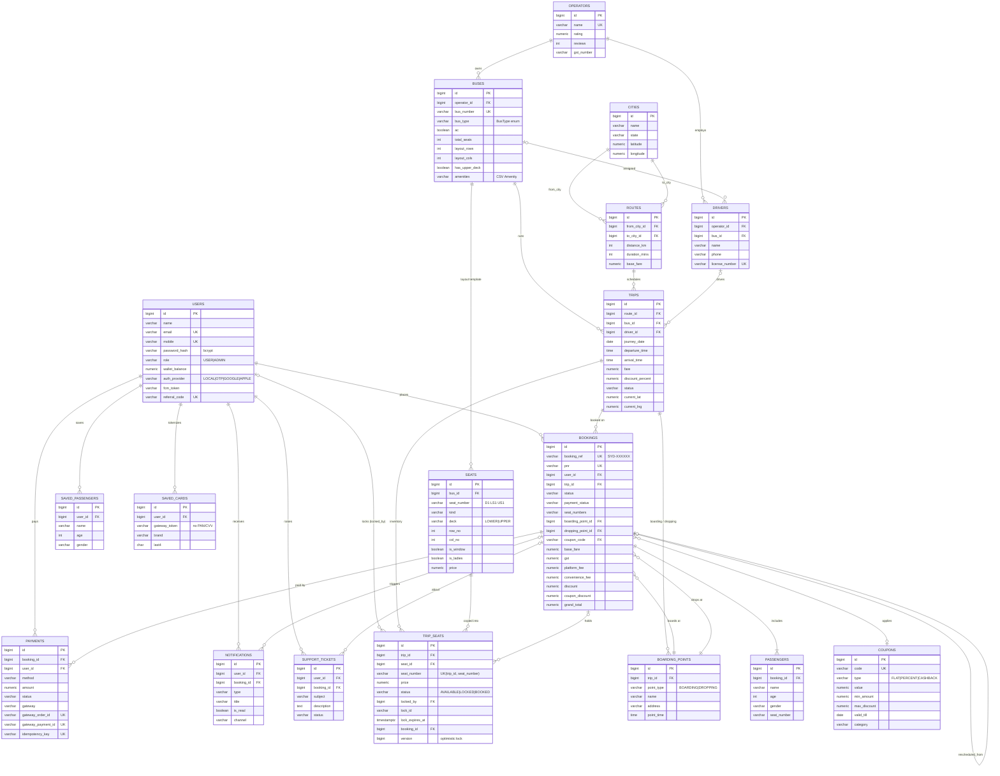

# Select Your Destiny — Entity Relationship Diagram

Source of truth: [`schema.sql`](./schema.sql). Audit columns (`created_at`, `updated_at`) exist on every table and are omitted below for brevity.

## Key constraints & indexes

| Purpose | Object |
|---|---|
| No double booking | `UNIQUE trip_seats(trip_id, seat_number)` + `version` optimistic lock + conditional `UPDATE ... WHERE status='AVAILABLE'` |
| Lock TTL sweep | partial index `trip_seats(lock_expires_at) WHERE status='LOCKED'`, function `release_expired_seat_locks()` |
| Search | `routes(from_city_id, to_city_id)`, `trips(route_id, journey_date)`, trigram on `cities.name` |
| Ticket lookup | `UNIQUE bookings.booking_ref`, `UNIQUE bookings.pnr` |
| Payment idempotency | `UNIQUE payments.idempotency_key`, `gateway_order_id`, `gateway_payment_id` |
| My trips | `bookings(user_id, created_at DESC)` |
| Admin reports | `bookings(created_at)`, `payments(status, created_at)` |
