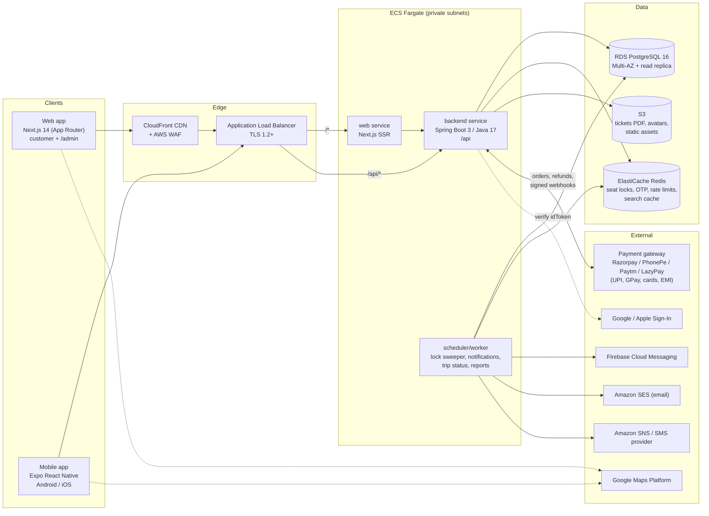
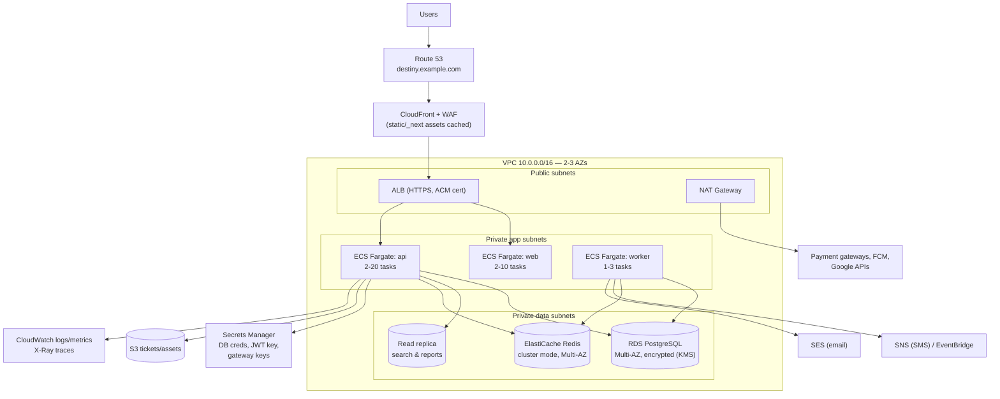

# Select Your Destiny — Architecture

> "Book Smart. Travel Comfortably." — a RedBus-style intercity bus booking platform.
> Binding API/type contract: [CONTRACT.md](./CONTRACT.md). Flows: [FLOWS.md](./FLOWS.md). Design: [UI_UX.md](./UI_UX.md). Data model: [../database/ERD.md](../database/ERD.md).

## 1. System overview

### Components

| Component | Tech | Responsibility |
|---|---|---|
| Web | Next.js 14, TypeScript, Tailwind, Framer Motion | Customer booking journey, `/admin` console (role `ADMIN`) |
| Mobile | Expo (React Native, TS), React Navigation, Reanimated | Customer journey, push notifications, live tracking map |
| Backend | Spring Boot 3, Spring Security (JWT), Spring Data JPA, Flyway-compatible schema | REST `/api`, response envelope `{success,data,message}` |
| Database | PostgreSQL 16 (H2 in `dev` profile) | System of record, see `database/schema.sql` |
| Cache / locks | Redis 7 | Seat-lock TTL keys, OTP codes, rate-limit buckets, hot search results |
| Object storage | S3 + CloudFront | Ticket PDFs (pre-signed URLs), operator logos, avatars |
| Notifications | FCM, SES, SNS/SMS | Booking confirmation, delay alerts, offers |

### Backend module layout (`com.selectyourdestiny`)
`auth` (JWT, OTP, social) · `catalog` (cities, routes, trips, search) · `seat` (layout, lock/release) · `booking` (quote, create, cancel, reschedule, ticket PDF) · `payment` (gateway adapters, webhook, refunds) · `user` (profile, wallet, saved passengers/cards) · `notification` · `support` · `admin` (CRUD, dashboard, reports) · `common` (ApiResponse envelope, exception handler, audit).

Profiles: `dev` → H2 in-memory + `ddl-auto=update` + data seeding + OTP `123456` + mock payments. `prod` → PostgreSQL (`schema.sql`), `ddl-auto=validate`, real secrets from env/Secrets Manager.

## 2. AWS deployment

| Concern | AWS service | Notes |
|---|---|---|
| Containers | ECR + ECS Fargate | Images built from `infra/*.Dockerfile`; blue/green via CodeDeploy |
| Database | RDS PostgreSQL 16 | Multi-AZ, automated backups (7-35 days), PITR, Performance Insights, IAM auth optional |
| Seat locks / OTP | ElastiCache Redis | `SET seat:{tripId}:{seat} {userId} NX PX 600000` |
| Static web | S3 + CloudFront | `_next/static` immutable caching; Next SSR stays on Fargate |
| Mobile builds | EAS Build / Submit | Store binaries; OTA updates via EAS Update |
| Secrets | Secrets Manager + KMS | Injected into ECS task definitions as `secrets:`; rotation for DB |
| Messaging | SNS (SMS), SES (email), FCM (push) | Async via SQS queue `notifications` consumed by worker |
| Async | SQS + EventBridge Scheduler | Booking events, lock sweep every 30 s, trip auto-complete |
| Observability | CloudWatch, X-Ray, Container Insights | Alarms: 5xx rate, p95 latency, payment failures, DB CPU |
| Edge security | WAF, Shield Standard | Managed rules + rate rules on `/api/auth/*` |
| CI/CD | GitHub Actions → ECR → ECS | Test → build → scan (Trivy) → deploy staging → manual prod approval |

## 3. Security

### Authentication & authorization
- **JWT** (HS512 dev / RS256 prod with key in Secrets Manager). Access token 15-60 min; refresh token (opaque, hashed in DB/Redis, rotated on use, 30 days). `Authorization: Bearer <token>`.
- Roles `USER`, `ADMIN`; `/api/admin/**` requires `ROLE_ADMIN` (Spring method security + Next.js middleware guard on `/admin`).
- Passwords: BCrypt cost 10-12. Account lockout after 5 failed logins / 15 min.
- **Social login**: Google/Apple `idToken` verified server-side against issuer JWKs (audience = our client IDs). Dev profile trusts the token.

### OTP abuse protection
- 6-digit OTP, stored hashed in Redis with 5-minute TTL; max 5 verify attempts per OTP.
- Rate limits (Redis token bucket / Bucket4j): 1 send per 30 s per mobile, 5 per hour per mobile, 20 per hour per IP; WAF rate rule as a second layer.
- Dev mode (`OTP_DEV_MODE=true`) accepts `123456` and logs the generated code. **Must be false in prod.**

### Payments & PCI-DSS scope reduction
- Card data never touches our servers: the client uses the gateway's hosted checkout / SDK (Razorpay Checkout, PhonePe PG, Paytm JS Checkout) and we receive only tokens/ids → **SAQ-A** scope.
- `saved_cards` stores gateway token + brand + last4 + expiry only (RBI card-on-file tokenization). No PAN/CVV, ever.
- **Server-side amount**: amount is recomputed from the booking on `/payments/initiate`; the client never dictates price.
- **Signature verification**: `/payments/verify` checks `HMAC_SHA256(order_id|payment_id, key_secret)`; webhooks `/api/payments/webhook/{gateway}` verify `X-Razorpay-Signature` (or PhonePe `X-VERIFY` checksum) with constant-time compare, reject stale timestamps, and dedupe on event id.
- **Idempotency**: `Idempotency-Key` header → `payments.idempotency_key` (unique). Retries return the original result; booking confirmation is a guarded state transition (`PENDING → CONFIRMED` only once).

### Platform hardening
- TLS everywhere (ACM at ALB; RDS/Redis in-transit encryption). Encryption at rest with KMS.
- CORS allowlist (web origin + Expo dev origins), CSRF not needed for bearer APIs; Next.js sets strict CSP, HSTS, `X-Frame-Options: DENY`.
- Input validation (Jakarta Bean Validation) and parameterized JPA queries; global exception handler never leaks stack traces.
- PII minimisation: passenger data retained per policy; logs mask mobile/email; audit columns on every table.
- Mobile: tokens in `expo-secure-store` (Keychain/Keystore), never AsyncStorage.
- Dependency scanning (Dependabot, OWASP dependency-check), container scanning, least-privilege IAM task roles.

## 4. Seat inventory & concurrency

Two-layer locking guarantees no double booking:

1. **Redis fast path** — `SET seat:{tripId}:{seatNo} {userId}:{lockId} NX PX 600000` for each seat (Lua script to make the multi-seat lock atomic). Fails → `409 Conflict`.
2. **Database truth** — `UPDATE trip_seats SET status='LOCKED', locked_by=?, lock_id=?, lock_expires_at=now()+'10 min', version=version+1 WHERE trip_id=? AND seat_number IN (...) AND (status='AVAILABLE' OR (status='LOCKED' AND lock_expires_at<now()))`; affected rows must equal seat count, else rollback + 409. JPA `@Version` protects concurrent edits.
3. Payment success converts `LOCKED → BOOKED` (only if still owned by the user's `lock_id`). If a lock has expired but the payment succeeded, the seats are re-acquired if free, otherwise the payment is auto-refunded.
4. Sweeper (`release_expired_seat_locks()` / scheduled job every 30 s) frees expired locks; Redis keys expire on their own.
5. Real-time availability: clients poll `GET /trips/{id}/seats` every 10 s on the seat screen (upgrade path: WebSocket/STOMP topic `/topic/trips/{id}/seats` fan-out via Redis pub/sub).

## 5. Scalability & performance

- **Stateless API** — JWT auth, no server sessions → horizontal ECS auto-scaling on CPU (60%) and ALB request count.
- **Search path** — indexed `routes(from_city_id,to_city_id)` + `trips(route_id,journey_date)`; results cached in Redis per `(from,to,date)` for 30-60 s, availability counts patched from Redis; read replica for search and admin reports.
- **Write path** — short transactions, row-level locks on `trip_seats` only for the seats requested.
- **Data growth** — partition `trip_seats`, `bookings`, `payments` by month on `journey_date`/`created_at` once volume exceeds ~50M rows; archive completed trips older than 18 months to S3 (Parquet) for analytics.
- **Async everything non-critical** — notifications, PDF generation, emails, analytics are queued (SQS) so booking latency stays < 300 ms p95.
- **Connection management** — HikariCP (max 20/task) behind RDS Proxy to survive scale-outs.
- **Peak events** (festival sales) — pre-warm ECS min tasks, Redis cluster scaling, WAF bot control, queue-based virtual waiting room if needed.
- **Mobile/web performance** — CDN-cached assets, Next.js ISR for popular route landing pages, image optimization, skeleton loaders, optimistic UI for seat selection.

## 6. Environments

| Env | Data | Payments | OTP | Infra |
|---|---|---|---|---|
| dev (local) | H2 or docker Postgres seed | MOCK (`signature: "mock"`) | `123456` | `mvn spring-boot:run`, `npm run dev`, `npx expo start` |
| staging | anonymised snapshot | gateway **test** keys | real SMS to allowlist | same AWS topology, smaller sizes |
| prod | live | live keys | real | Multi-AZ, autoscaling, alarms |
