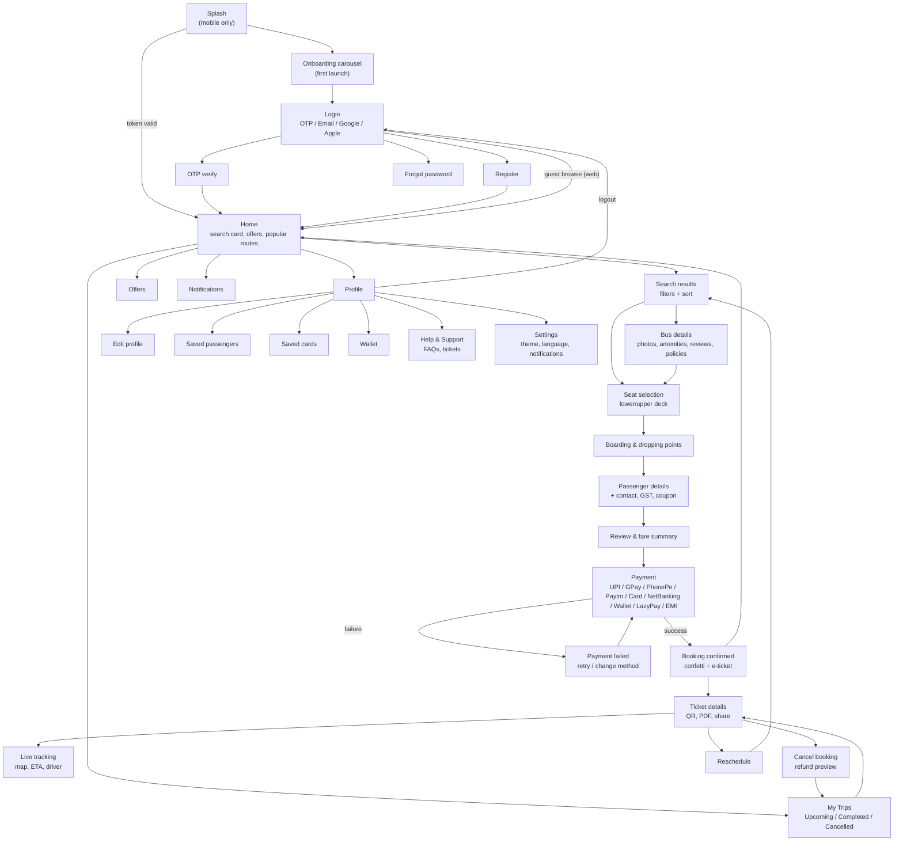
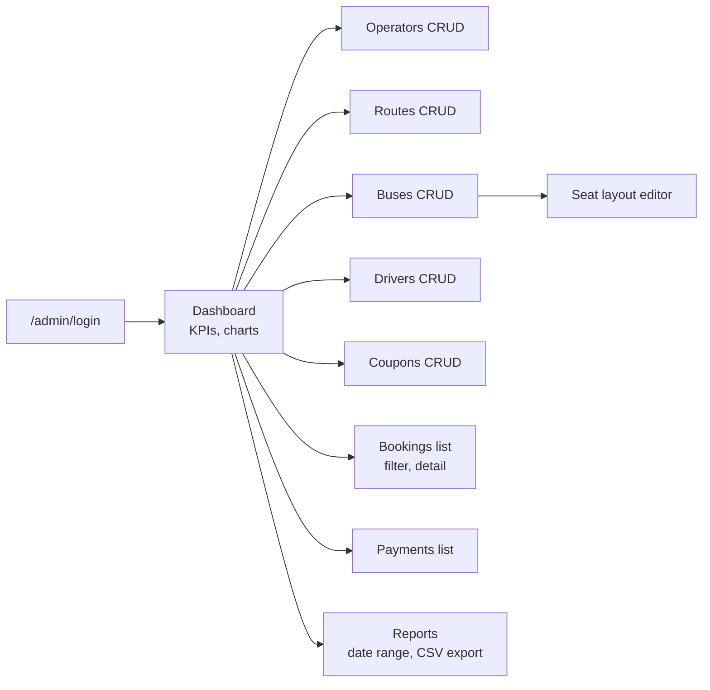
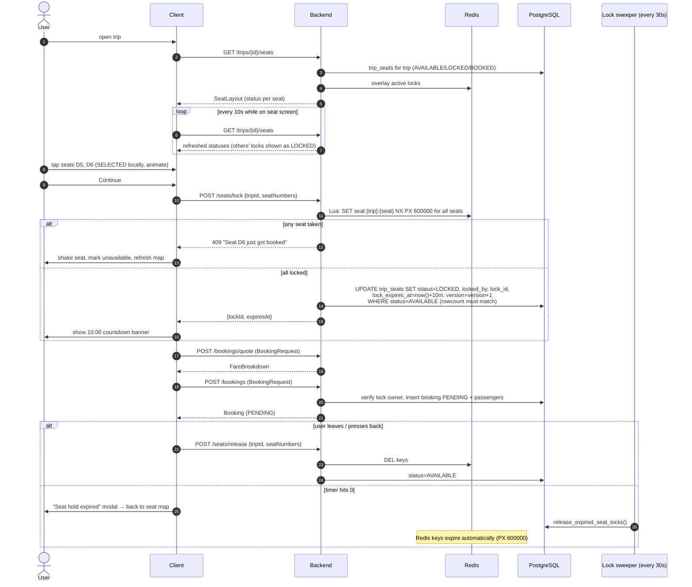
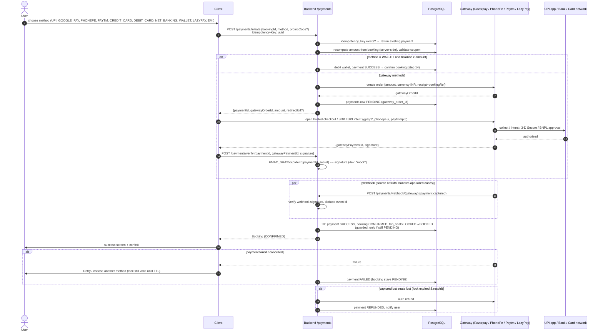
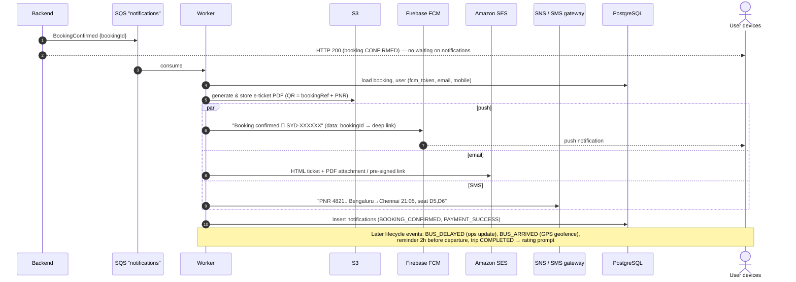
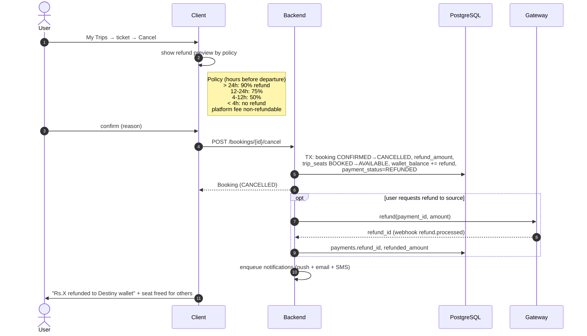

# Select Your Destiny — Flows

All endpoints are under `/api` and return `{ success, data, message }` (see [CONTRACT.md](./CONTRACT.md)).

## 1. Navigation flow

### 1.1 Customer app (web + mobile share the same journey)



Mobile bottom tabs: **Home · My Trips · Offers · Profile** (Notifications via bell icon). Web: top nav with the same sections + footer.

### 1.2 Admin console (`/admin`, role ADMIN)



## 2. Authentication flow

```mermaid
sequenceDiagram
  autonumber
  actor U as User
  participant C as Client (web/mobile)
  participant API as Backend /api/auth
  participant R as Redis
  participant SMS as SMS provider
  participant IDP as Google/Apple

  rect rgb(235,242,255)
  note over U,SMS: Mobile OTP
  U->>C: enter mobile
  C->>API: POST /auth/otp/send {mobile}
  API->>R: rate-limit check (1/30s, 5/h per mobile, 20/h per IP)
  alt limit exceeded
    API-->>C: 429 "Too many requests"
  else ok
    API->>R: SET otp:{mobile}=hash(otp) EX 300, attempts=0
    API->>SMS: send OTP (dev: log it, accept 123456)
    API-->>C: {sent:true}
  end
  U->>C: enter 6-digit OTP
  C->>API: POST /auth/otp/verify {mobile, otp}
  API->>R: compare hash, attempts++ (max 5)
  API->>API: find-or-create user (auth_provider=OTP)
  API-->>C: AuthResponse {token, user}
  end

  rect rgb(243,232,255)
  note over U,API: Email + password
  C->>API: POST /auth/login {email,password}
  API->>API: BCrypt verify, lockout after 5 failures
  API-->>C: AuthResponse
  end

  rect rgb(255,237,224)
  note over U,IDP: Social login
  C->>IDP: Google / Apple sign-in SDK
  IDP-->>C: idToken
  C->>API: POST /auth/social {provider, idToken}
  API->>IDP: verify signature (JWKs), aud, exp
  API-->>C: AuthResponse
  end

  note over C: store token (web: httpOnly cookie or memory; mobile: SecureStore)

  rect rgb(232,250,240)
  note over C,API: Token refresh (prod extension, not in v1 contract — v1 issues a 24h token and re-login on 401)
  C->>API: any request with Authorization: Bearer access
  API-->>C: 401 token expired
  C->>API: POST /auth/refresh {refreshToken}
  API->>R: validate + rotate refresh token (reuse ⇒ revoke family)
  API-->>C: new access + refresh
  C->>API: retry original request
  end
```

## 3. Seat booking — real-time availability & lock TTL



## 4. Payment integration



Reconciliation job every 15 min queries the gateway for `PENDING` payments older than 10 min and settles them.

## 5. Booking confirmation & notifications



## 6. Cancellation & refund



Reschedule (`POST /bookings/{id}/reschedule`) = lock seats on the new trip → create new booking with `rescheduled_from_id` → fare difference charged (payment flow) or credited to wallet → old booking cancelled without penalty if > 12 h before departure.
